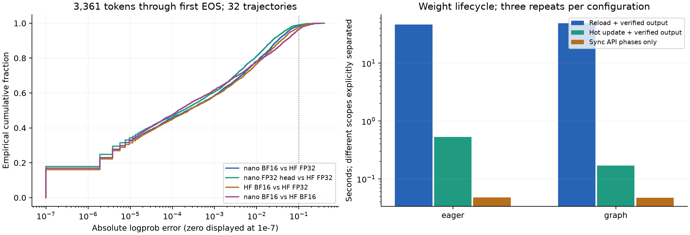
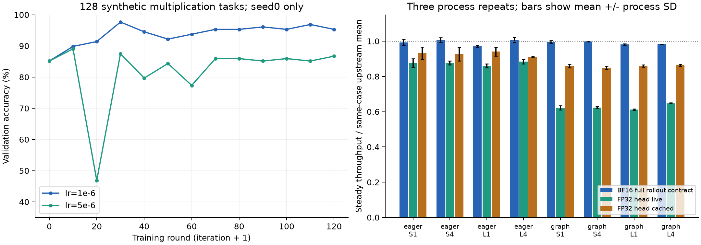

# Lockstep-RL

Single-GPU synchronous GRPO and rollout diagnostics built on
[nano-vllm](https://github.com/GeeeekExplorer/nano-vllm), with token-aligned
logprobs, transactional weight updates and explicit KV-cache invalidation.
MIT/upstream attribution is preserved. Fixed upstream:
`bb823b3e06983d71485a8e1f23715ebd87d98ef8`.

## Measured results

The completed campaign used **Qwen3-0.6B on one NVIDIA L40S 48GB**, Anhui,
driver 580.126.09, Python 3.11, torch 2.8.0+cu128, Transformers 5.5.4 and official
FA2 2.8.3.post2. Experimental source was the clean commit
`ce9e3542b3f31475ffa595e3f09b80e3f9190ed0`; later commits publish evidence and analysis.

| Measurement | Observed result | Scope |
| --- | --- | --- |
| nano BF16 vs HF FP32 logprob error | Mean 0.00993; P99 0.12159 | 32 GSM8K trajectories; 3,361 tokens through first EOS inclusive |
| FP32 head vs HF FP32 | Mean 0.00785; P99 0.09717 | Mean error reduced 21.0%; live/cached head checked separately |
| GPU-FP32 → BF16 actor synchronization | 47.9 ms eager / 47.5 ms graph | Preflight + commit + invalidation; three repeats; no cached FP32 head |
| Hot update vs reload, including verified output | 88.0× eager / 290.1× graph | Matching lifecycle timing; includes diagnostic weight-change counting |
| BF16 rollout extension vs upstream throughput | −2.96% to +0.74% | Eight backend/workload combinations; three processes each |
| Cached FP32 head throughput cost | 12.2–14.9% graph; 3.1–9.6% eager | Relative to current BF16 implementation |
| CUDA graph / eager throughput | 3.90–4.53× | Four tested workloads |
| Simple-task validation, lr=1e-6 | 109/128 → 122/128 (85.2% → 95.3%) | One seed, 120 rounds; recomputed anchor, one update per batch |



The error distribution pools tokens. Timing bars explicitly separate synchronization
phases from end-to-end recovery; comparing 48 ms with a 45–48 s reload gives
different timing scopes. The matched end-to-end speedups are shown in the table.



Learning curves have no seed uncertainty band because only seed 0 was run.
Throughput bars use three independent process means; error bars show process SD,
not confidence intervals, and do not propagate uncertainty in the upstream
normalization. S1/S4: 32 prompt / 32 output tokens, one/four requests;
L1/L4: 1,024 prompt / 64 output tokens, one/four requests.

All **13 orchestration jobs exited successfully**, including 24 baseline,
14 diagnostic, 25 weight-sync and 96 performance workers. The full run took
2 h 41 min; clean-commit preflight plus full run took 3 h 01 min. These replace
the earlier unmeasured rental estimates. Successful execution does not mean all
logprob discrepancies meet a chosen tolerance.

Read the [analysis and limitations](analysis/l40s-20261027/REPORT.md),
[recomputed statistics with input hashes](analysis/l40s-20261027/recomputed.json),
[measurement provenance](results/l40s-20261027/README.md), and
[complete raw-result Release](https://github.com/Nana1mi/Lockstep-RL/releases/tag/l40s-20261027).

## What the evidence supports

- Eager replay and batch-1 graph replay were bit-identical on the tested tokens.
  Eager batch 4 and graph bucket 4 with three actual requests also matched each
  other. This is evidence about these groupings, not proof that all companions
  are irrelevant or that a particular GEMM kernel caused the differences.
- Cached and recomputed preemption paths are separate experiments. Primary
  diagnostics end at first EOS; all 735 post-EOS tokens remain separate.
  Pooled, per-trajectory and threshold-exceedance data are published.
- Low-probability tokens have substantially larger logprob error. A diagnostic
  ratio outside [0.8, 1.2] is not itself evidence that training clipping was active.
- All six stale-cache negative controls were detected. Hot-updated parameter
  hashes matched directly loaded B. The 48 ms sync measurement does not include
  maintenance of the optional cached FP32 head.
- Both 120-round demonstrations used `anchor=recomputed`, `update_steps=1`:
  their ratios were 1 and clipping was inactive. The small `two-updates` positive
  control reached 2.22% active clipping; the rollout-anchor smoke had 2.22% ratio
  exceedance but zero active clipping. This is not a substantive anchor comparison.
- The higher learning rate, 5e-6, was unstable: validation reached 46.9% at round
  20 and finished at 86.7%. The 1e-6 improvement is a single-seed result on easy
  synthetic multiplication, not evidence of improved GSM8K learning.
- Throughput overhead is small in this matrix, but cannot all be called noise:
  graph long-multi dropped 1.65%, larger than its observed process variation.

## Implementation and limits

`enable_prefix_caching` controls lookup/hash registration. `fp32_lm_head` uses
live conversion; `cache_fp32_lm_head` uses a nonpersistent inference buffer refreshed
after successful loading/commit, including tied-weight updates. Failed commits
close the engine to further generation. Updates require idle TP=1, preserve
physical KV allocation/compatible graphs, and invalidate logical KV/prefix state.
`sync_seconds` sums preflight, commit and invalidation; optional change measurement
has its own timer. Fixed probe scores and changed BF16 parameter fractions provide
evidence beyond version increments.

GRPO uses group-normalized advantages, response-token normalization and epsilon
0.2 clipping. **beta=0: no reference model or reference KL**. Response positions
are gathered before head projection. Reward parsing has strict/lenient modes and
explicit failure statuses. All configured EOS IDs stop real rollouts.

The demo used 16 prompts × G=8, 512/128 disjoint train/validation tasks,
microbatch 16, accumulation 8, inference fraction 0.4 and no backbone checkpointing.
The memory probe and completed runs validate those tested shapes. There was no
controlled microbatch-1 vs microbatch-16 speed ablation. No TP updates, async RL,
LoRA sync, automatic rollback or dynamic KV offload are implemented.

## Reproduce analysis on CPU

The numerical analysis uses the standard library; figures additionally require
Matplotlib. Download the small published result ZIP manually to include paired
validation, trace and negative-control checks. No models, datasets or GPU are needed.

```bash
CUDA_VISIBLE_DEVICES= python analysis/analyze_l40s.py --raw-archive /path/to/l40s-20261027-results.zip
CUDA_VISIBLE_DEVICES= python -m unittest discover -s analysis -p 'test_*.py' -v
```

Use `--no-plots` without Matplotlib. Without `--raw-archive`, token/performance/sync
analysis still runs; raw-only checks are explicitly marked unavailable.

## Development and future experiments

Use independent Python 3.11 environments on Linux/WSL. Base imports do not require
FA2/Triton or initialize CUDA. Existing CPU regression passed **109 tests in each**
of the torch 2.11.0+cpu and 2.8.0+cpu environments; analysis checks are separate.

```bash
bash scripts/setup_cpu_env.sh /path/to/python3.11
CUDA_VISIBLE_DEVICES= .envs/nano_rl/bin/python -m unittest discover -s tests -v
.envs/nano_rl/bin/ruff check --select E9,F lockstep_rl nanovllm scripts tests analysis example.py bench.py
.envs/nano_rl/bin/python scripts/validate_cpu_artifacts.py
.envs/nano_rl/bin/python scripts/run_rental.py --persistent-root /persistent/lockstep --dry-run
```

The [follow-up plan](analysis/l40s-20261027/FOLLOWUP.md) prepares seed replication
and a matched two-update anchor comparison. Config generation and dry runs do not
execute training. Follow-up GPU work remains **GPU_PENDING**.

[GPU_RUNBOOK.md](GPU_RUNBOOK.md) documents opt-in setup, `--allow-download`,
`--allow-gpu`, preflight, task timeouts/process cleanup and retry stages under fresh
run IDs. Only environment/attention failures block independent jobs. Future-host
placeholders in `configs/rental.json` deliberately remain templates; observed
hardware, mount and network values are in the published run records. Revalidate
them on a new host. Keep assets/environments/results on the data disk. All contrasts
must use the same GPU model, region, driver and pinned stack. A100/RTX 5080 notes
and the [upstream README](docs/upstream-readme.md) are historical, not these measurements.
