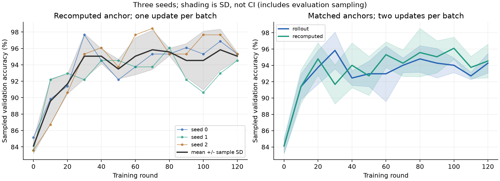

# L40S follow-up evidence — 2026-10-27

Nine runs completed **120 rounds each**, all exit0, no failures or timeouts.
Experimental source: `ce9e3542b3f31475ffa595e3f09b80e3f9190ed0`, clean throughout.
Configuration preparation: `d333ff53d610f7401d1fa2e87d9bc0c6a70d2435`.
Fixed upstream: `bb823b3e06983d71485a8e1f23715ebd87d98ef8`.
Publication commits add evidence after execution.

One NVIDIA L40S 48GB, Anhui, driver580.126.09, Python3.11.18,
torch2.8.0+cu128, Transformers5.5.4, official FA2 2.8.3.post2, Triton3.4.0.
The platform assigned a new UUID after reboot, so all three replication seeds were
rerun on this same GPU; the earlier seed0 was not pooled.
Started22:20:03, finished23:08:40 Hong Kong time; wall2916.87s (48min37s).

| Final sampled validation accuracy | seed0 | seed1 | seed2 | Mean | Sample SD |
| --- | ---: | ---: | ---: | ---: | ---: |
| Recomputed,1update | 95.31% | 94.53% | 95.31% | 95.05% | 0.45pp |
| Rollout,2updates | 94.53% | 95.31% | 92.97% | 94.27% | 1.19pp |
| Recomputed,2updates | 92.97% | 96.88% | 93.75% | 94.53% | 2.07pp |



Fixed128 structured multiplication validation tasks; evaluation samples at
temperature1.0. Shading is sample SD, not CI; seed spread includes training and
evaluation sampling. Initial scores were85.16%,83.59%,83.59% by seed.
n=3 and this easy task do not establish an anchor winner from the0.26pp mean gap.

All runs start from original Qwen3-0.6B weights: lr1e-6,16prompts × G8,
max_tokens128, train512/validation128, microbatch16/accumulation8,
inference fraction0.4, eager, no backbone checkpointing. beta=0, no reference model.
Matched anchor pairs differ only in anchor; both use two updates. Every successful
commit records BF16 parameter changes and a fixed-trajectory logprob probe.
A skipped zero-variance batch is not an optimizer step.

All six two-update runs activated clipping. Counting **every update** in
metrics.jsonl, rollout had318/446 updates with nonzero active clipping; recomputed
had219/476. These are update counts, not token clipping rates. Per-update maxima
and ratio bounds are in [summary.json](summary.json); [training/](training/) retains
both updates in steps.csv. One-update recomputed runs retained ratio1 and zero clipping.

## Files and reproduction

- [manifest.json](manifest.json), [plan.json](plan.json): exact commands, source,
  GPU identity, per-job timeout/cleanup/return codes and config hashes.
- [preflight/](preflight/): environment, attention and observed rental identity.
- [input-precheck.json](input-precheck.json): pinned weight/config hashes and package versions.
- [training/](training/): exact config/metrics.csv/summary/plot/numerics/provenance,
  a compact initial-evaluation summary, and derived per-update steps.csv.
- [runtime/](runtime/): actual external orchestration and read-only monitoring source;
  these are historical runtime artifacts, not entry points to start another run.
- [publication.json](publication.json): input-to-publication mapping and original byte hashes.
  Some frozen config labels say GPU_PENDING; completed execution is established by
  manifest, environment and raw metrics, not by rewriting those labels.

Recompute the plot and statistics using only these small files:

```bash
CUDA_VISIBLE_DEVICES= python analysis/analyze_followup.py
```

Run from the repository root. Matplotlib is needed for the figure; `--no-plots`
uses only the standard library. [recomputed.json](recomputed.json) records45 input
hashes and all three seed curves, cross-checked against original JSONL summaries.

## Complete raw results

The [Release](https://github.com/Nana1mi/Lockstep-RL/releases/tag/l40s-followup-20261027)
contains **followup-ce9e354-01-results.zip**,21,221,376bytes,
SHA256 `8971ca9cb1ba66358dcc94228bd4290380f0f013abde693214b90f7c22e0b6de`,
plus SHA256SUMS. It is the unchanged original archive; ZIP CRC and all1,201 internal
manifest entries were byte/hash verified. It includes detailed trajectories,
all validation outcomes and per-update JSONL, logs and launch configuration.
Weights/checkpoints, environments and standalone task-list dataset files are excluded.

The campaign is finished and the heartbeat was deleted after verified backup.
Platform billing is controlled by the operator. This publication does not start
another experiment or change the fixed experimental source.
